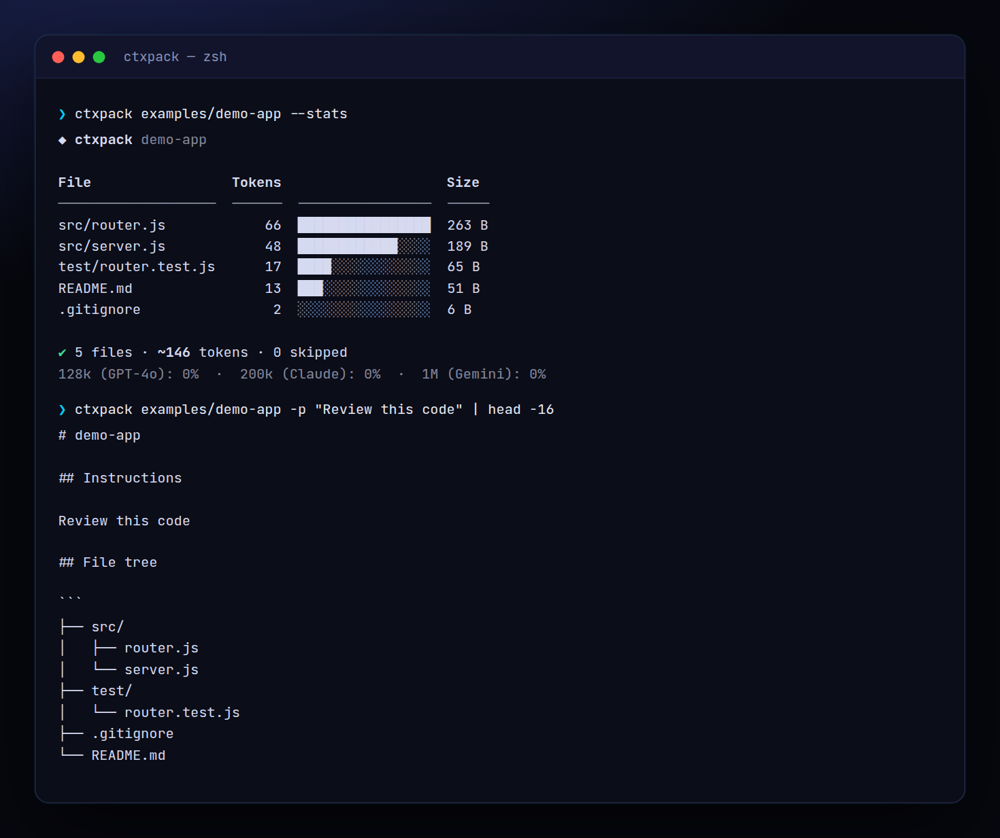

<!-- ═════════════ HEADER ═════════════ -->
<p align="center">
  
</p>

<p align="center">
  
</p>

<p align="center">
  <a href="https://github.com/krishyaa06/prism-context-pack/actions/workflows/ci.yml"></a>
  
  
  <a href="LICENSE"></a>
</p>

<p align="center">
  
</p>


## ⚡ Overview

**Prism Context Pack** (`ctxpack`) turns a project folder into one prompt you can paste into ChatGPT, Claude, Gemini or any agent. It walks the repo while respecting `.gitignore`, skips `node_modules`, build output, binaries, images and lockfiles, and writes a file tree followed by every file in a fenced block (or XML tags). `--stats` shows which files use the most tokens and how much of each model's context window the pack fills.

## ✨ Features

- **.gitignore-aware** walker with built-in ignores (`node_modules`, `dist`, `.next`, `.git`, venvs…)
- Skips **binaries, images, lockfiles, minified files** and files over `--max-kb`
- **Markdown** (safe nested fences + language tags) or **XML** output
- `--include` / `--exclude` globs, `--prompt` instructions at the top
- `--stats`: token breakdown per file + context-window fit
- `--copy` to clipboard (pbcopy / wl-copy / xclip / clip), zero dependencies

## 🚀 Quick Start

```bash
# run without installing
npx github:krishyaa06/prism-context-pack . --stats

# or install globally
npm install -g github:krishyaa06/prism-context-pack
ctxpack . -o context.md
```

Requires Node.js 18.17+. No dependencies.

## 🛠️ Usage

```text
ctxpack [dir] [options]

  -o, --out <file>        write to a file (default: stdout)
  -f, --format <fmt>      markdown | xml
  -i, --include <glob>    only include matching paths (repeatable)
  -x, --exclude <glob>    exclude matching paths (repeatable)
  -m, --max-kb <n>        skip files larger than n KB (default: 200)
  -p, --prompt <text>     add instructions at the top
      --copy              copy result to the clipboard
      --stats             token breakdown instead of the pack
      --no-gitignore      don't respect .gitignore
```

```bash
ctxpack . -o context.md
ctxpack src -i "**/*.ts" --stats
ctxpack . -x "test/**" -p "Find bugs in this code" --copy
```

## 📁 Project Structure

```
prism-context-pack/
├── assets/
│   ├── logo.png
│   └── logo.svg
├── bin/
│   └── ctxpack.js   # CLI entry
├── examples/
│   └── demo-app/
│       ├── src/
│       │   ├── router.js
│       │   └── server.js
│       ├── test/
│       │   └── router.test.js
│       ├── .gitignore
│       └── README.md
├── src/
│   ├── index.js   # collect + render
│   ├── ui.js   # colours, tables
│   └── walk.js   # gitignore-aware walker
├── test/
│   └── ctxpack.test.js
├── .gitignore
├── LICENSE
└── package.json
```

## 🧪 Tests

```bash
npm test
```

Tests use the built-in `node:test` runner, so there is nothing to install. CI runs them on Node 20 and 22.

## 🤝 Contributing

1. Fork the repo and create a branch: `git checkout -b feature/my-idea`
2. Make your change and add a test in `test/`
3. Run `npm test` and open a Pull Request

## 🔷 Part of Prism Protocol

Prism Context Pack is one of the open-source tools built by [Prism Protocol](https://dc.gg/prismprotocol), a tech community where young builders learn, ship and compete together.

## 👤 Author

<table>
  <tr>
    <td align="center">
      <a href="https://github.com/krishyaa06"><br><b>Soumya Bhandare</b></a><br>
      <sub>Founder @ Prism Protocol</sub>
    </td>
    <td>
      <a href="https://dc.gg/prismprotocol"></a><br>
      <a href="https://instagram.com/prism_protocol_"></a><br>
      <a href="https://x.com/krishyaa06"></a>
    </td>
  </tr>
</table>

## 📄 License

Released under the [MIT License](LICENSE).

<p align="center">
  <b>If you like this project, consider giving it a ⭐</b><br>
  <sub>"Build. Create. Compete." · Made with ⚡ by Prism Protocol</sub>
</p>


